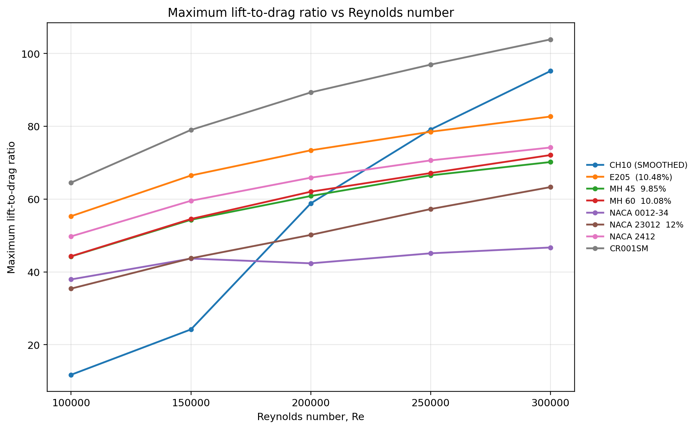
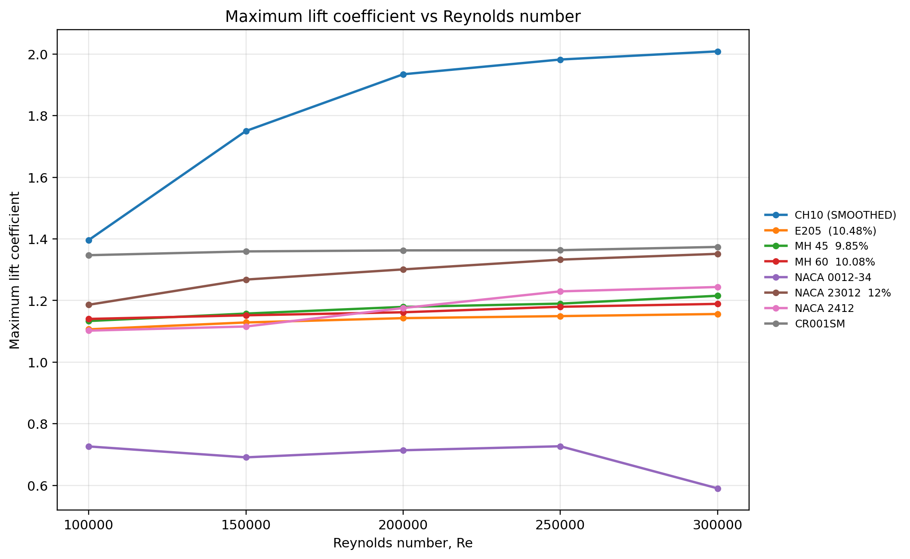
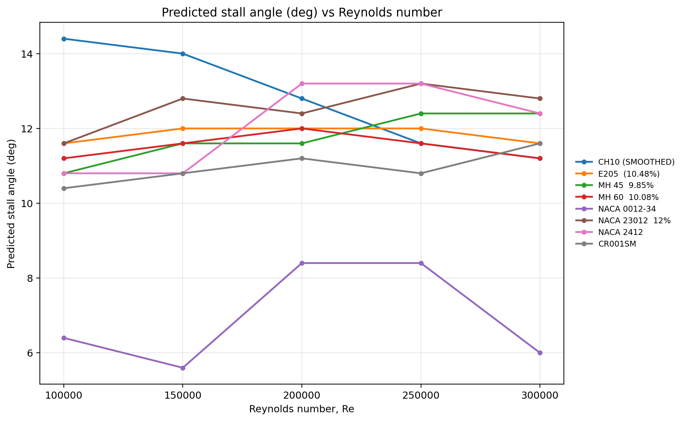
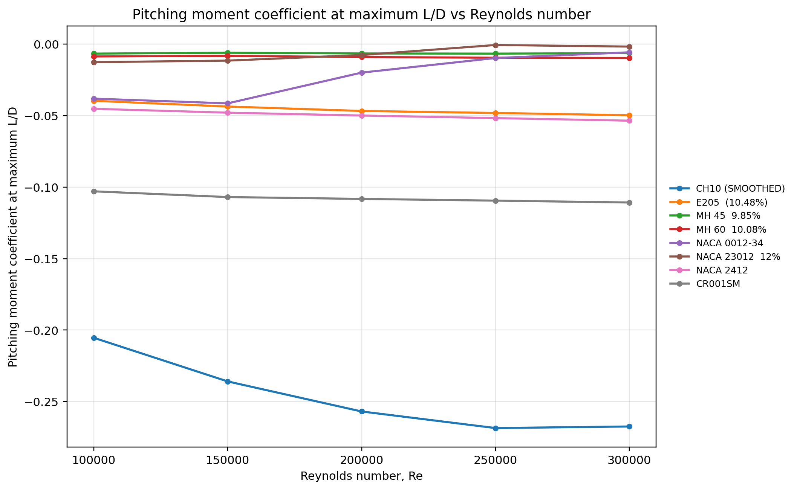
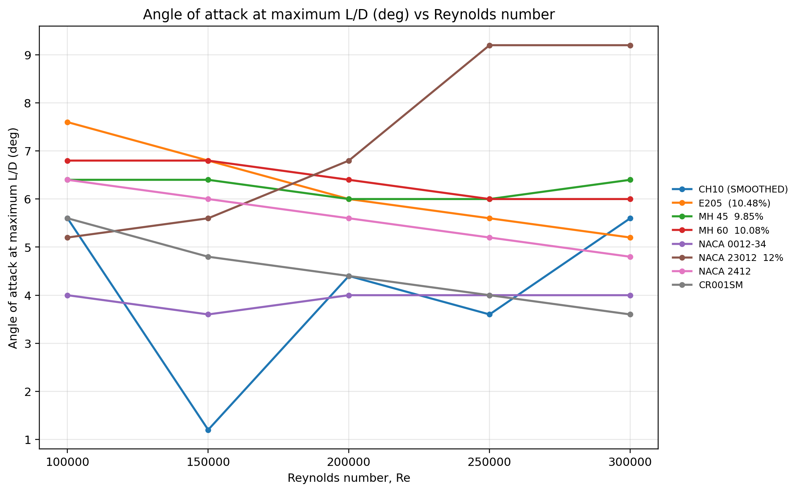

# Airfoil Comparison: Results and Discussion

## Dataset and methodology

Eight candidate airfoils were compared using exported XFLR5 summary results at five Reynolds numbers (100,000, 150,000, 200,000, 250,000, and 300,000). Each record includes the maximum lift coefficient, reported stall angle, maximum lift-to-drag ratio, angle at maximum L/D, and pitching moment coefficient at maximum L/D. The comparisons represent numerical predictions and have not been experimentally validated.

## Results

### Maximum lift-to-drag ratio



CR001SM has the highest reported maximum L/D among the eight candidates at all five Reynolds numbers in this dataset. For CR001SM, maximum L/D rises from **64.53 at Re = 100,000** to **103.88 at Re = 300,000**. Note that each maximum L/D occurs at its own angle of attack and is not a comparison at a common operating lift coefficient.

### Maximum lift coefficient



CH10 (SMOOTHED) has the highest reported maximum lift coefficient at every Reynolds number tested. For example, at Re = 200,000, the reported CL max is **1.9344** for CH10 compared with **1.3628** for CR001SM. This could matter for low-speed performance, but aircraft stall speed also depends on wing area, mass, and three-dimensional wing effects.

### Predicted stall angle



CR001SM's reported stall angles vary from **10.4° to 11.6°** over the tested Reynolds numbers. These are two-dimensional analysis results and should not be used directly as aircraft stall angles.

### Pitching moment at maximum efficiency



At Re = 200,000, the pitching moment coefficient at maximum L/D is **-0.1083** for CR001SM and **-0.2569** for CH10 (SMOOTHED). These values apply at the respective maximum-efficiency conditions, not necessarily the same angle of attack or lift coefficient. They do not by themselves determine aircraft trim or stability.

### Angle of attack at maximum efficiency



For CR001SM, the reported angle at maximum L/D decreases from **5.6° at Re = 100,000** to **3.6° at Re = 300,000**.

## Preliminary selection

**CR001SM remains the preliminary selected airfoil** because it achieves the highest reported maximum L/D at every tested Reynolds number and has a less negative pitching moment coefficient at maximum L/D than CH10. The results do **not** establish that CR001SM is the best airfoil at the aircraft's actual cruise or launch condition. This requires comparing drag at a common operating lift coefficient, checking stall-speed requirements, reviewing full polar curves, and evaluating the 3D wing and whole-aircraft configuration.

## Limitations and next verification steps

- Verify XFLR5 settings, convergence, transition assumptions, and the method used to identify stall angles.
- Compare candidates at the expected aircraft operating Reynolds number and lift coefficient, not only at their individual maxima.
- Evaluate full polars and assess 3D wing and aircraft stability effects.
- Check sensitivity to manufacturing tolerances and surface roughness.
- Validate design predictions with ground and flight tests after construction.

## Reproducibility

The source dataset is `airfoil_summary.csv`. Regenerate plots using:

```bash
python plot_airfoil_comparison.py --csv airfoil_summary.csv --out Figures
```

Requires Python with `pandas` and `matplotlib`.
