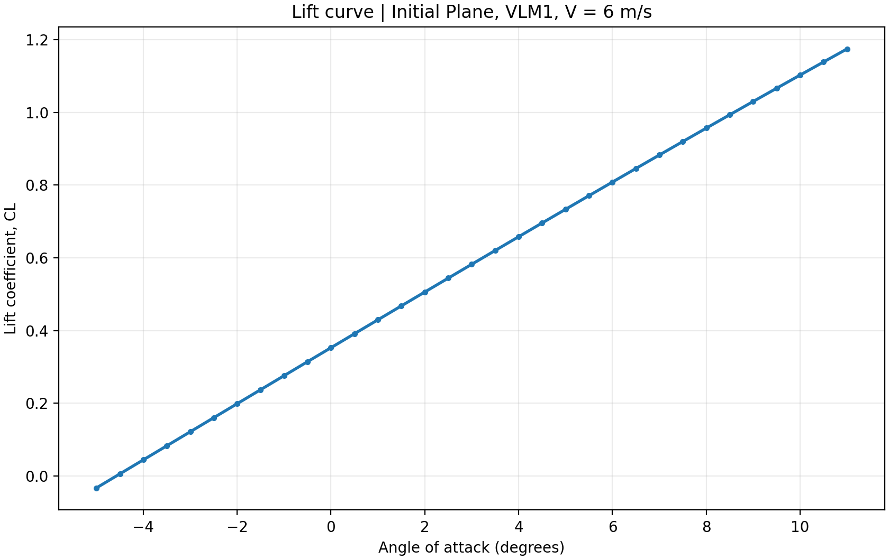
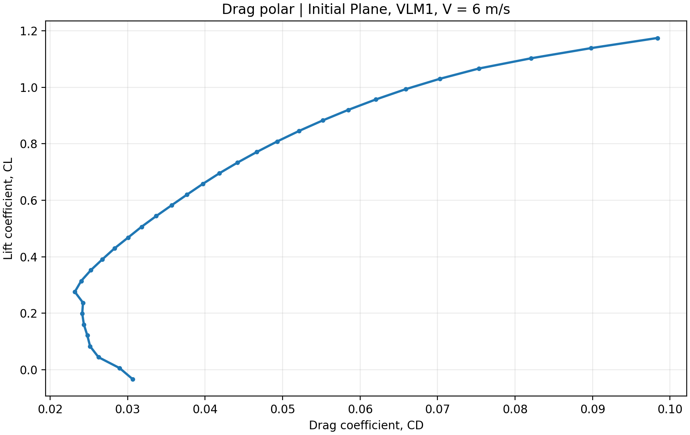
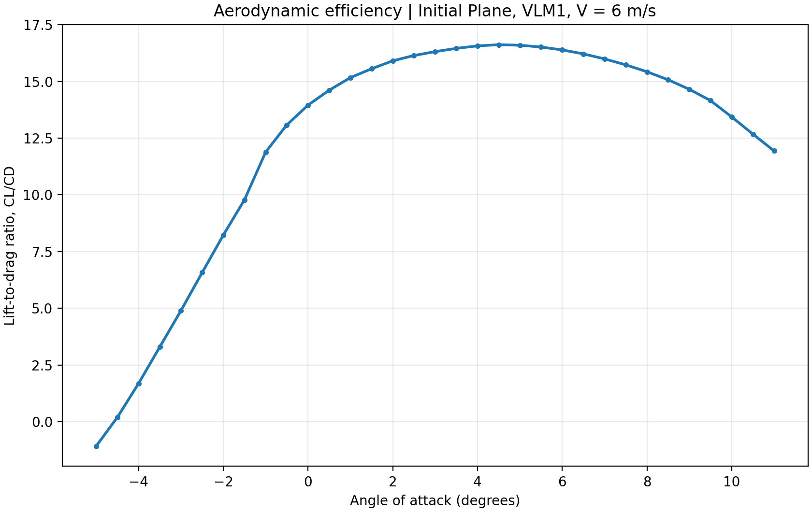
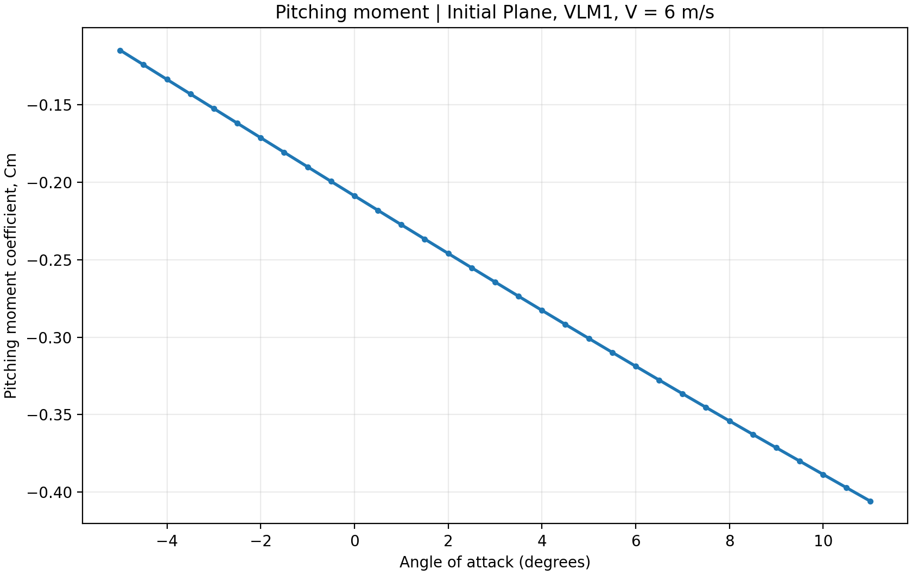
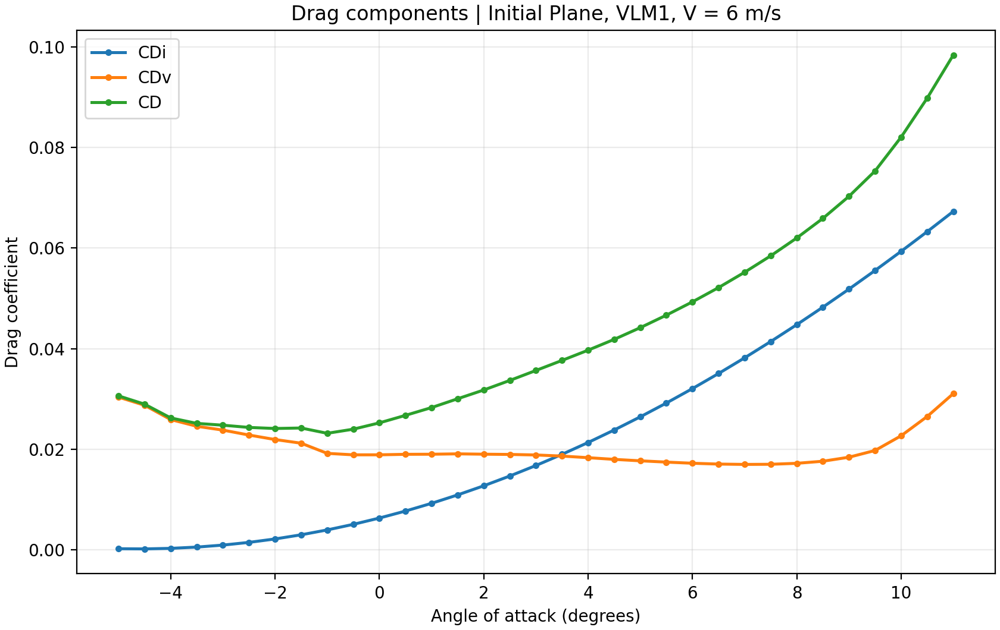

# Three-Dimensional Aircraft Aerodynamic Analysis

**Project:** Fixed-Wing RC Aircraft Design  
**Author:** Elias Hayek  
**Model:** `Initial Plane` (XFLR5)  
**Polar:** `T1-6.0 m/s-VLM1`  
**Status:** Preliminary computational analysis

## 1. Purpose

This section documents an exported XFLR5 VLM1 polar for the **aircraft model**, not necessarily an isolated wing. The goal is to understand predicted lift, drag, aerodynamic efficiency, and pitching moment as functions of angle of attack at the specified freestream speed.

## 2. Conditions and dataset

| Setting | Value |
|---|---|
| XFLR5 version shown in export | 6.62 |
| Model name | Initial Plane |
| Polar name | T1-6.0 m/s-VLM1 |
| Freestream speed | 6.0 m/s |
| Sideslip, beta | 0 degrees |
| Angle of attack | -5 to +11 degrees |
| Step | 0.5 degrees |
| Exported observations | 33 |

The input data is [`wing_polar_6ms.csv`](wing_polar_6ms.csv). Reproduce all figures with:

```bash
pip install pandas matplotlib
python plot_wing_polars.py
```

## 3. Results

### Lift coefficient versus angle of attack



The exported lift coefficient increases from approximately -0.033 at -5 degrees to 1.175 at +11 degrees. The highest **sampled** CL, 1.174597, is at the upper endpoint of the sweep, not a demonstrated CLmax or stall condition. At 0 degrees, CL = 0.352680.

### Drag polar



Drag generally increases with lift at larger angles of attack. At 4.5 degrees, CL = 0.695724 and CD = 0.041857. These values are dimensionless coefficients referenced to XFLR5's chosen reference geometry.

### Aerodynamic efficiency



The maximum **sampled** CL/CD is approximately **16.62 at 4.5 degrees**. This is the peak within the exported points only; it should not be assumed to be the true continuous optimum.

### Pitching moment



The reported Cm decreases from -0.114668 at -5 degrees to -0.405722 at +11 degrees. At zero degrees, Cm = -0.208697. A Cm trend alone cannot establish full aircraft stability without confirming reference point, CG position, and analysis assumptions. Do not interpret the lack of a Cm zero crossing as proof of untrimmable flight without those inputs.

### Drag components



The export provides induced drag (`CDi`), viscous drag (`CDv`), and total drag (`CD`). Their relative contributions are shown across the sampled angles. The plotted drag results remain model predictions.

## 4. Interpretation and limitations

- This is a **computed XFLR5 VLM1 aircraft-model polar**, not measured flight-test data.
- The results represent **one fixed speed (6 m/s)**. They do not give performance over a speed range.
- The analysis does **not establish stall speed**, because the sweep does not verify separation behavior or an actual maximum lift coefficient.
- A 6 m/s freestream setting is **not evidence of achieving the 6 m/s stall-speed target**.
- Confirm reference area, span, chord, CG, incidence, mass, and full model geometry before translating coefficients into forces or evaluating trim and stability.
- The dataset alone does not provide lift distribution along the wing span.

## 5. Next analyses

- [ ] Record wing reference area, span, mean chord, and aircraft mass.
- [ ] Check actual reference point and center of gravity for pitching moments.
- [ ] Review multiple speeds and compare their polars.
- [ ] Check stall performance with more suitable aerodynamic methods and validate in flight.
- [ ] Document spanwise lift distribution separately if XFLR5 results are available.
- [ ] Compare predicted performance with ground and flight-test measurements.

## 6. Reproducibility

Run [`plot_wing_polars.py`](plot_wing_polars.py) with the original export in the same folder. The five figures under [`Figures/`](Figures/) are generated directly from the CSV with no manual adjustment to the coefficients.
